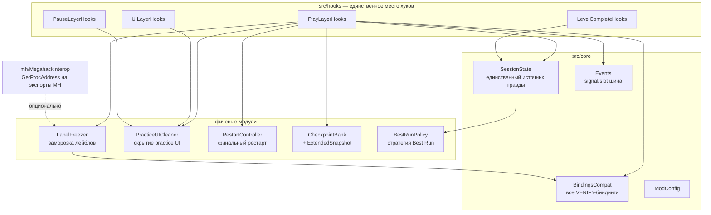
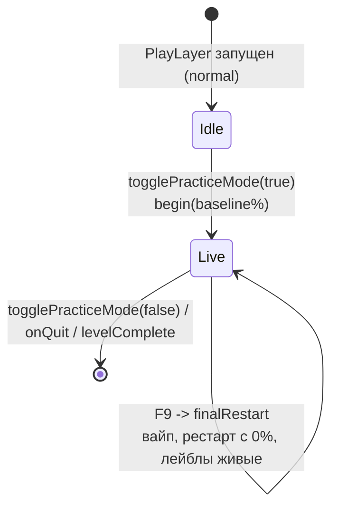

# Ghost Practice — Architecture

> **TL;DR для ИИ-контрибьютора:** читай этот файл целиком перед правками.
> Правило №1: вся фальшь — только в памяти (Volatile-Only). Правило №2:
> неопределённые биндинги идут в `src/core/BindingsCompat.hpp` с меткой
> `VERIFY(...)` и нигде больше. Правило №3: хуки только в `src/hooks/`,
> модули общаются через `Events`/`SessionState`, не напрямую.

## 1. Что делает мод

Играя в practice-режиме, игрок видит и «предъявляет» окружению обычный
normal-режим:

| Фича | Статус P0 |
|---|---|
| Скрытие practice-иконок: кнопок чекпоинтов, алмазов, надписей | каркас + эвристика |
| Экран победы в варианте normal-режима | каркас (VERIFY флаги bool) |
| Заморозка лейблов MegaHack V9 (FPS/CPS/Best Run/...) на чекпоинте | реализовано (pinning) |
| Best Run: чекпоинт «банкует» процент, смерть откатывает к банку, в реальном времени | реализовано |
| Финальный рестарт (F9): вайп чекпоинтов, старт с 0% | реализовано |
| Прогресс-бар/проценты: зелёный маркер best — in-memory спуф | реализовано (VERIFY поле) |
| Абсолютно точное восстановление мира (партиклы/мувы/пилы/триггеры) | фазируется, P3–P5 |

## 2. Карта модулей



Зависимости направлены строго: `hooks -> feature -> core`. Фичевые модули
не импортируют друг друга (общение через `Events`), кроме явно указанных
(`RestartController` пользуется `LabelFreezer`/`CheckpointBank` — это
допустимо, он — оркестратор одного действия).

## 3. Жизненный цикл сессии



Сессия начинается в `togglePracticeMode(true)` — это ловит и вход через
паузу, и старт со стартпоза (baseline = текущий %). Всё состояние сессии —
в `SessionState` (singleton, только главный поток).

## 4. Поток данных на чекпоинте

```
PlayLayer::createCheckpoint (hook, pre)
  └─ PracticeUICleaner::beforeCreateCheckpoint — цензус нод
PlayLayer::createCheckpoint (original)      — движок сохраняет свой чекпоинт
PlayLayer::createCheckpoint (hook, post)
  ├─ PracticeUICleaner::afterCreateCheckpoint — дифф: скрыть новые ноды (алмаз)
  ├─ CheckpointBank::push — наш ExtendedSnapshot (+ % на момент)
  ├─ SessionState::onCheckpoint — банкует Best Run
  └─ LabelFreezer::freeze — снапшот текстов всех совпавших лейблов
далее каждый кадр (PlayLayer::update post):
  └─ LabelFreezer::onFrame — перепиннить тексты, если MH их перезаписал
```

## 5. Заморозка лейблов: доказанная механика

Факты (из анализа `absolllute.megahack.geode` v9.1.3, см. FEASIBILITY.md):

1. MH **не** имеет собственного DX-оверлея: в импортах нет d3d/dxgi, зато
   есть `libcocos2d.dll` → весь UI MH рисуется cocos-нодами игры.
2. RTTI подтверждает: лейблы — это `CCLabelBMFont` (обёртки
   `tabcore::text::Label` / `status::Label`).
3. Форматы текстов: `' FPS'`, `' CPS'`, `'Best Run: {}'`, `'Attempt {}'`;
   Geode-ID нод: `checkpoints-label`, `percentage-label`.
4. У MH есть экспортный API `hackpro::extensions` (isHackEnabled,
   getConfigVar и т.д.) — используется опционально через
   `mh/MegahackInterop`, для заморозки не нужен.

Механизм: `LabelFreezer` снапшотит текст совпавших лейблов и **каждый кадр
переписывает его обратно**, если MH обновил. Мы пишем после MH в том же
кадре → его апдейты гарантированно перетираются. Никаких хуков на чужой
код, никакой зависимости от оффсетов — переживает обновления MH.

Ограничение честно задокументировано: если какой-то лейбл не подходит ни
под один префикс/ID — добавь его в настройки `freeze-label-patterns` /
`freeze-label-node-ids` (это конфиг, не код).

## 6. Лестница точности восстановления мира (P3–P5)

«Точь-в-точь заторможено» — это лестница, а не бинарное свойство:

| Ступень | Что восстанавливается | Механизм |
|---|---|---|
| P3 | Всё, что умеет ванильный чекпоинт 2.2 (физика игроков, размеры, режимы, часть каунтеров) | движок сам (`CheckpointObject`) |
| P3+ | Каунтеры/триггеры, не покрываемые ванилью | `ExtendedSnapshot` + хук `loadFromCheckpoint` |
| P4 | Камера, музыка (позиция трека), групповые скорости | поля в `ExtendedSnapshot` |
| P5 | Партиклы попиксельно | снапшот массивов `CCParticleSystemQuad` (дорого; по умолчанию выкл) |

**Честная оценка:** 100% побитовая идентичность (включая внутренние RNG
и аудио-стейт) недостижима; 95–99% визуальной неотличимости — достижима
поэтапно. Не обещай в коде больше, чем реализовано, — каждая ступень
включается только вместе с capture И restore.

## 7. Принцип Volatile-Only (не нарушать)

Вся фальшь живёт **только в памяти текущей сессии**:

- `m_level->m_normalPercent` перезаписывается каждый кадр, но **никогда**
  не сохраняется (practice-путь движка не пишет прогресс — VERIFY при
  обновлениях GD);
- НИКОГДА не вызывать `GJGameLevel::savePercent`, не трогать
  `GameStatsManager`/`GameManager`-статистику, не писать в CCFileUtils;
- причина: (а) порча сейва, (б) бан-волны RobTop за модифицированную
  статистику, (в) этот мод — про запись/представление сессии, а не про
  подделку аккаунт-данных.

Если пользователь попросит «настоящую» запись прохождения — это отдельная
фича с отдельными рисками, решение принимает человек, не ИИ.

## 8. Как расширять (рецепты)

**Добавить поле в снапшот:** `state/Snapshot.hpp` (поле + комментарий) →
capture в `hooks/PlayLayerHooks.cpp::createCheckpoint` → restore в хуке
`loadFromCheckpoint` (создать при необходимости). Одним PR, без мёртвых
полей.

**Поддержать новый лейбл:** обычно — только правка настроек (префикс/ID).
Если нужен спец-парсинг значения — расширь `LabelFreezer::matches`.

**Изменить логику Best Run:** только `progress/BestRunPolicy.hpp`. Стартпоз-
семантика — осознанное решение пользователя, не выбор ИИ (см. TODO там).

**Заменить Win32-хоткей на Geode keybinds:** внутренности
`RestartController::update`, контракт `performFinalRestart` не меняется.

**Добавить хук:** файл в `src/hooks/`, регистрация через `$modify`,
все обращения к другим модулям — через `Events`/`SessionState`.

## 9. Конвенции кода

- C++20; всё в namespace `ghost` (+ `ghost::compat`, `ghost::mh`).
- Метка `VERIFY(...)` = «не подтверждено на 2.2081; проверить по ROADMAP
  phase 0». Такие вещи живут только в `BindingsCompat` или помечены в
  хуках. После проверки метку снять.
- Логи: префикс `[GhostPractice]`, уровень info для событий сессии,
  debug для нод.
- Один модуль — одна ответственность; Год-объектов нет (ближайший —
  `SessionState`, но он хранит только числа и флаги).
- Сборка: только GitHub Actions (`.github/workflows/build.yml`,
  geode-sdk/build-actions@v1). Локально ничего не собираем.

## 10. Файлы

```
mod.json                  метаданные + настройки (все ключи — в ModConfig)
CMakeLists.txt            glob src/**, include-dir src
.github/workflows/build.yml
src/main.cpp              баннер, детект MH
src/core/                 Events, ModConfig, BindingsCompat, SessionState
src/progress/             BestRunPolicy (стратегия)
src/state/                Snapshot, CheckpointBank
src/labels/               LabelFreezer
src/ui/                   PracticeUICleaner, RestartController
src/mh/                   MegahackInterop (экспортный API MH)
src/hooks/                PlayLayer, UILayer, PauseLayer, LevelCompleteLayer
docs/FEASIBILITY.md       вердикты по фичам + доказательства по MH
docs/ROADMAP.md           фазы P0..P5 + чеклисты приёмки
```
